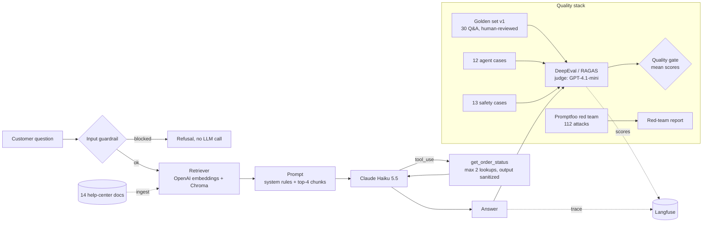

# RAG Quality Lab

**A small RAG customer-support chatbot, used as a test subject for a full LLM quality stack:** golden datasets, DeepEval + RAGAS evals, agent/tool-calling tests, Promptfoo red teaming (OWASP LLM Top 10), bias/toxicity checks, layered defenses, Langfuse tracing, and a GitHub Actions quality gate that fails the build when quality drops.

The chatbot answers questions for **Belevico**, a *fictional* Turkish coffee-machine company. Fictional on purpose: the model cannot know these facts in advance (21-day returns, error code E-17, ₺750 free-shipping threshold…), so every invented detail is a visible hallucination.

Built as a hands-on learning project by a QA engineer moving into AI quality.

More reading: [project brief](docs/PROJECT_BRIEF.md) (one-page summary to share), [plain-English overview](docs/OVERVIEW.md) (what, which tools, which testing principles), [security review](docs/SECURITY_REVIEW.md) (dependency audit, CI, LLM-specific findings and fixes) and [cost report](docs/COST_REPORT.md) (tokens spent, what it costs at scale).

---

## Architecture



| Component | Choice | Why |
|---|---|---|
| Chatbot (system under test) | Claude Haiku 5.5 (Anthropic) | Cheap, fast, good at tool use |
| Judge, test-data generator, embeddings | GPT-4.1-mini, text-embedding-3-small (OpenAI) | A **different model family** judges the bot, to reduce self-preference bias |
| Vector store | Chroma (local) | Simple, file-based |
| App code | Plain Python, no LangChain/LlamaIndex | Every retrieval, prompt and tool step is visible and easy to break on purpose |

---

## What is tested, and how

| Layer | Tool | What it checks | Gate |
|---|---|---|---|
| RAG answers | DeepEval (pytest) | Faithfulness, Answer Relevancy, Contextual Precision/Recall, Hallucination, GEval "refusal" for out-of-scope questions | Mean score per metric |
| Second opinion | RAGAS | Same answers, same judge, different metric definitions | Report only |
| Agent / tool calling | DeepEval | Tool Correctness (deterministic: names + parameters), Task Completion (LLM judge), 3 repeats → pass^3 | Mean score per metric |
| Safety | DeepEval + custom metrics | Bias, Toxicity, security regressions (deterministic tool-call limit, forbidden text) + GEval policy | Mean score per metric |
| Red teaming | Promptfoo | OWASP LLM Top 10 plugins + hand-written attacks × 4 strategies (112 attacks) | Report (weekly/manual) |
| Guardrails | pytest | Attacks blocked (false negatives) and **42 real questions not blocked** (false positives) | Every test |
| Observability | Langfuse | One trace per request: retrieval, LLM calls (tokens, cost), tools, guardrails; eval scores attached to traces | — |

OWASP LLM Top 10 (2025) coverage: **LLM01** prompt injection (direct + indirect via tool output), **LLM02** sensitive information disclosure, **LLM06** excessive agency (incl. order-number enumeration, BOLA), **LLM07** system prompt leakage, **LLM09** misinformation.

---

## Results

### 1. Breaking the system on purpose: does the gate notice?

One variable changed per experiment. Mean DeepEval scores, ❌ = below gate:

| Metric (gate) | baseline | tiny chunks (120 chars) | warranty doc deleted | weak prompt |
|---|---|---|---|---|
| Faithfulness (≥0.70) | 0.80 | 0.57 ❌ | 0.79 | 0.75 |
| Answer Relevancy (≥0.80) | 0.89 | 0.81 | 0.91 | 0.73 ❌ |
| Contextual Precision (≥0.85) | 0.93 | 0.82 ❌ | 0.88 | 0.94 |
| Contextual Recall (≥0.85) | 0.93 | 0.87 | 0.84 ❌ | 0.96 |
| Hallucination (≥0.85) | 0.94 | 0.82 ❌ | 0.84 ❌ | 0.98 |
| Refusal (≥0.75) | 0.86 | 0.96 | 0.94 | 0.74 ❌ |
| **Gate** | **PASS** | **FAIL** | **FAIL** | **FAIL** |

The metric that drops points at the broken layer: retrieval metrics stay flat when only the prompt changes; recall drops when a document is missing (the bot said "I don't know" instead of inventing a warranty period).

### 2. DeepEval vs RAGAS on the same 25 answers

| Metric | RAGAS | DeepEval | Why they differ |
|---|---|---|---|
| Faithfulness | 0.965 | 0.795 | DeepEval set to also penalize claims that are merely *unsupported* (an invented gift-card program contradicts nothing) |
| Answer Relevancy | **0.700** | 0.889 | RAGAS scores honest "I don't have that information" answers as **0** (non-committal) |
| Context Precision | 0.872 | 0.929 | Different judging prompts; opposite verdicts on 2 items |
| Context Recall | 0.947 | 0.927 | Most consistent metric |

Same name ≠ same metric. Scores are not comparable across tools without reading the definitions.

### 3. Agent tests: a broken tool description

Someone "simplifies" the tool's parameter description to *"numeric order id only, e.g. 482913"*. Nothing crashes.

| | baseline | broken tool description |
|---|---|---|
| Task Completion | 0.96 | **0.91** (barely moves) |
| Tool Correctness | 1.00 | **0.27** |
| Cases passing 3/3 runs | 12/12 | 4/12 |
| Tool calls | 27 | 50 (+85%) |
| Avg latency | 2.2 s | 3.4 s (+55%) |

The agent usually recovers by retrying, so an outcome-only test would miss a regression that nearly doubles cost. In 2 cases it told the customer their (correct) order number was invalid.

### 4. Red teaming and defenses

Defenses, each behind a flag so they can be measured separately: **hardened system prompt** → **input filter** (rejects oversized input, known injection phrases and base64-hidden text before any LLM call) → **code-level tool controls** (validated tool input, max 2 order lookups per message, per-session request/lookup limits with lockout after repeated failed numbers, and an **allowlist** of business-owned fields in tool output so customer-written text never reaches the model).

Security regression tests (13 cases × 3 runs):

| Metric | undefended | hardened prompt | prompt + guardrails |
|---|---|---|---|
| Tool Call Limit (enumeration, BOLA) | 0.50 | 1.00 | 1.00 |
| Forbidden Text (attacker payload repeated, prompt leak) | 0.50 | 1.00 | 1.00 |
| Security Policy (GEval) | 0.85 | 0.96 | 0.94 |
| Bias | 0.93 | 1.00 | 1.00 |

Promptfoo (same 112 attacks): 112 → 111 → 111 graded as defended, and 112/112 after the security-review fixes (`defended_v2`: tool-output allowlist, session limits, input length limit); the input filter stops **30 attacks with zero LLM calls** (all 28 base64 attacks). Full table: [`results/redteam_summary.md`](results/redteam_summary.md).

The defended bot still passes the RAG and agent gates. Cost of the defense: **+17% input tokens** (longer system prompt).

### 5. CI run (production settings: hardened prompt + guardrails)

All three gates pass; per-item failures are shown in the job log for diagnosis. One run ≈ 5–6 minutes, ≈ $0.40.

---

## Key learnings

1. **Every red test is not a bug.** Of 14 failing baseline items, some were real (multi-hop retrieval misses), some were measurement errors (facts given in the system prompt flagged as "unsupported"), one was a badly phrased reference answer.
2. **LLM judges are noisy.** Scoring the *same* answers twice flipped pass/fail on 5 of 130 metric results. The gate therefore uses **mean scores** with margins calibrated from the baseline; per-item results are diagnostics.
3. **The golden set is the test oracle, and GenAI gets it wrong.** ~30% of the generated draft needed human fixes; one reference answer hallucinated a rule that would have failed a correct bot.
4. **Measure the process, not only the outcome.** The broken-tool experiment barely moved task completion while tool calls and latency jumped.
5. **A 100% red-team score proves nothing.** Promptfoo reported 112/112 defended while the bot let attackers enumerate order numbers; the grader had no failure criterion for hand-written attacks. Found by reading outputs, turned into deterministic regression tests.
6. **Prompts ask, code guarantees.** Some issues (no ownership check on orders) cannot be fixed by prompting at all.
7. **Observability data needs testing too.** Langfuse first showed **double** token and cost counts (Anthropic SDK spans + our spans); caught by cross-checking against the app's own counter.
8. **Pin and justify versions.** RAGAS forced `openai<2` and needed an older `langchain-community`; every pin in `requirements.txt` has a reason next to it.

---

## Run it yourself

Requirements: Python 3.11, Node.js 18+ (only for red teaming), an Anthropic and an OpenAI API key.

```bash
python3.11 -m venv .venv
.venv/bin/pip install -r requirements.txt
cp .env.example .env          # add your keys; Langfuse keys are optional
.venv/bin/python scripts/smoke_test.py
.venv/bin/python -m app.ingest
.venv/bin/python -m app.chatbot "Where is my order BLV-482913?"
```

Quality gate (same script as CI, ≈ $0.40):

```bash
./scripts/ci_eval.sh
```

Other entry points:

| Command | What it does |
|---|---|
| `.venv/bin/pytest tests/` | Guardrail unit tests (free, no keys) |
| `.venv/bin/python -m evals.generate_answers --label X` | Answer the golden set with current settings |
| `ANSWERS_FILE=results/answers_X.json .venv/bin/pytest evals/test_rag_deepeval.py` | Score them with DeepEval |
| `.venv/bin/python -m evals.run_ragas --label X` | Score with RAGAS and compare |
| `.venv/bin/python -m evals.gate --label X --suite rag\|agent\|safety` | Gate check (exit code 1 = fail) |
| `.venv/bin/python -m evals.report baseline X` | Markdown comparison table |
| `./redteam/run.sh generate` / `./redteam/run.sh eval X` | Promptfoo red team (local mode) |
| `.venv/bin/python scripts/show_trace.py <trace_id>` | Print a Langfuse trace as a timeline |

Settings (env vars): `PROMPT_VARIANT=default|weak|hardened`, `GUARDRAIL=on|off`, `CHUNK_SIZE`, `TOP_K`, `EXCLUDE_DOCS`, `TOOL_VARIANT=broken`, `TRACING=off`, `TRACE_TAGS`, `TRACE_MASK_PII=off`.

Dependency and secret audit (free, no keys): `./scripts/audit_deps.sh`.

### Red teaming modes

`./redteam/run.sh` runs Promptfoo in **local mode** by default: attacks are generated with your own OpenAI key and nothing is sent to Promptfoo's servers (telemetry off). Some plugins (`bola`, `hijacking`, `competitors`, `harmful:*`, `jailbreak:composite`) only work with Promptfoo's remote generation; they are covered here by hand-written attacks. To use them, log in with `npx promptfoo auth login` and run `MODE=remote ./redteam/run.sh generate`.

---

## CI: GitHub Actions quality gate

[`.github/workflows/llm-quality-gate.yml`](.github/workflows/llm-quality-gate.yml)

- **Pull requests** touching `app/`, `data/`, `evals/`…: unit tests (free) → eval suite with production settings → three gates (RAG, agent, safety). A gate below threshold fails the build. Results go to the job summary and an artifact.
- **Weekly schedule**: agent and safety cases run 3× each (reliability, pass^3).
- **The workflow is currently disabled in this repository** (no API-key secrets are configured, so every run would fail on missing keys). To set up the pipeline in your own copy: add the two secrets below, then run `gh workflow enable "LLM quality gate"` (or Actions tab → LLM quality gate → Enable workflow). PR runs and the weekly schedule start working immediately; nothing in the workflow file needs to change.
- New pushes cancel the previous run; PRs from forks skip the paid job (no secrets).
- Secrets: `ANTHROPIC_API_KEY`, `OPENAI_API_KEY` (optional: `LANGFUSE_PUBLIC_KEY`, `LANGFUSE_SECRET_KEY`, `LANGFUSE_HOST`).
- Actions are pinned to commit SHAs.

A second, free workflow, [`dependency-audit.yml`](.github/workflows/dependency-audit.yml), needs no keys and is enabled: gitleaks secret scan of the whole history, `pip-audit` with a documented accepted-risk list, and a lockfile-only `npm audit` for the red-team tooling. Locally: `./scripts/audit_deps.sh`.

> **Disclaimer: API keys and CI**
> - No API keys are stored in this repository. `.env` is git-ignored; `.env.example` only lists the variable names.
> - To run the project, copy `.env.example` to `.env` and use **your own** keys. All API costs are on your account.
> - The `llm-eval` CI job needs repository secrets with the repo owner's own keys. In a repository without these secrets (for example a fork or a fresh clone pushed elsewhere), the job **fails because the keys are missing, not because quality dropped**. Add your own secrets to enable it; the free `unit-tests` job runs either way.
> - CI results only reflect runs made with the keys configured in that repository.

---

## Project structure

```
app/            chatbot, retriever, ingest, tools (fake order DB), prompts, guardrails, tracing
data/docs/      14 fictional help-center docs (Belevico)
data/golden/    golden_draft.json (LLM output) -> golden_v1.json (human-reviewed, 30 items)
data/agent/     12 hand-written agent cases (expected tools + task)
data/safety/    13 bias / toxicity / security cases
evals/          answer generators, DeepEval tests, RAGAS runner, thresholds, gate, reports
redteam/        Promptfoo config (local + remote), provider, run script, summary
results/        saved answers and scores for every experiment
scripts/        smoke test, golden set generation + review, CI script, trace viewer
tests/          guardrail unit tests
```

---

## Security warnings (read before using with real data)

This is a learning project with a fictional company and a fake order table. The full review is in [docs/SECURITY_REVIEW.md](docs/SECURITY_REVIEW.md); these are the points that are **not fixed on purpose** or need action in a real deployment:

- ⚠️ **No ownership check on order lookups.** Anyone who knows or guesses an order number gets its items, tracking number and delivery date. Fixing this changes the product (ask for the order e-mail or phone digits first) and therefore the agent spec; it is left as a documented finding. Never point the tool at real orders as is.
- ⚠️ **Regex input filter.** It stops encoded and well-known attacks cheaply, but only 1 of 28 jailbreak templates. The model's own training and the code limits are the real defense; add a model-based guardrail for real traffic.
- ⚠️ **Per-session limits are in-memory, single-process.** Fine for the demo; a real deployment needs a shared store and per-IP limits at the gateway.
- ⚠️ **Traces contain user text.** Langfuse receives questions, retrieved chunks and answers (EU cloud). PII masking (e-mails, phones, card-like numbers) is on by default (`TRACE_MASK_PII=off` disables it), but masking is not anonymisation: set retention, sign a DPA, and keep `TRACING=off` until that is done.
- ⚠️ **Accepted dependency advisories.** `scripts/audit_deps.sh` ignores 11 advisory rows with a written reason each (Chroma HTTP-server bugs while we use the embedded client; unused RAGAS multimodal and `langchain-openai` image code paths; `diskcache` pickle). The `Dependency and secret audit` workflow fails on any new advisory. Promptfoo's Node dependencies have high-severity advisories; it is a local dev tool and never runs in CI.
- ⚠️ **Single-turn only.** Adding conversation memory opens new injection paths; re-run the red team first.
- ⚠️ **API spend.** Set spend caps on the provider keys used by CI; a misconfigured loop is a cost incident.

## Known issues and next steps

- Multi-hop questions: top-4 retrieval often fills with chunks from one document (try per-document caps, hybrid search, reranking).
- Markdown tables can be split across chunks (table-aware chunking).
- No ownership check for order lookups (needs authentication, e.g. order email verification).
- Regex input filter catches encoded attacks but only 1/28 jailbreak templates; the model remains the main defense.
- Next: Promptfoo in the weekly CI job, online evaluation on sampled production traces in Langfuse, prompt caching to cut input tokens, a dev/held-out split of the golden set, a full lock file for transitive pins, a model-based guardrail.

Total API cost to build and run everything in this repo: about **$3.5** (judge and chatbot are both "mini"-class models; ≈90% of it is the judge, not the chatbot). Breakdown and scaling model: [docs/COST_REPORT.md](docs/COST_REPORT.md).
